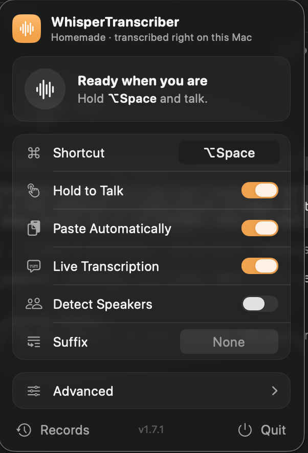
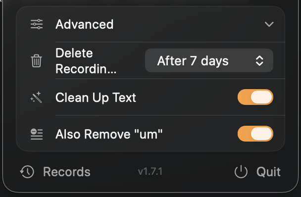

# WhisperTranscriber

WhisperTranscriber is a macOS menu bar app that records your microphone and turns what you say into text on your Mac. Press a shortcut, talk, and the transcript lands on your clipboard or goes straight into the app you were typing in. Transcription runs on the Neural Engine with Parakeet TDT v3 through [FluidAudio](https://github.com/FluidInference/FluidAudio), so your audio never leaves the Mac.

<p align="center">
  
  &nbsp;
  
</p>

Requires macOS 15.4 or later.

## Features

- **On-device transcription** with Parakeet TDT v3 on the Neural Engine, in 25 European languages. The app only goes online to download models.
- **A global shortcut** (⌥⌘S by default) that works from any app. Press it to start and again to stop, or hold it while you talk.
- **Live transcription**: your words show up in the popover phrase by phrase while you're still talking.
- **Silence trimming**: Silero VAD cuts the silence out before the final pass. Recordings with no speech in them are skipped instead of transcribed.
- **Speaker detection** (optional) labels each turn as `Speaker 1:`, `Speaker 2:` and so on, for conversations.
- **Text cleanup** removes filler words and tidies spacing and punctuation with fixed rules. No LLM is involved.
- **Clipboard and auto-paste**: every transcript is copied, and it can also be pasted into the app you're typing in. It's never pasted into WhisperTranscriber's own windows.
- **Suffix**: the same text added to the end of every transcript.
- **Records window**: each recording is kept as a WAV file, which you can transcribe again with different settings.
- **Old recordings deleted automatically** after 1, 7 or 30 days, if you choose.
- **A menu bar icon that shows what the app is doing.** See [The menu bar icon](#the-menu-bar-icon).
- **Private**: the app runs in the App Sandbox, and transcript text is never written to its logs.

## The menu bar icon

The icon changes shape and color with the app's state, so you can tell at a glance whether it's listening.

| Icon | Color | State |
|---|---|---|
| Waveform | Matches the menu bar | Idle, ready to record |
| Down arrow in a circle | Purple | Downloading the speech model (Lite, first launch only) |
| Hourglass | Red | Loading the speech model at launch |
| Filled microphone | Orange | Recording |
| Microphone with a waveform | Dark orange | Recording, with Live Transcription on |
| Speech bubble | Blue | Transcribing the recording |

Click the icon to open the popover. The status card at the top shows the same symbol, says what's happening, and gives a hint for your shortcut, such as "Press ⌥⌘S to start talking." or "Let go of ⌥Space when you're done." Live text appears under it while you speak. The settings come next, then a footer with **Records**, the app version and **Quit**.

## Usage

1. Launch the app, and its icon appears in the menu bar. The Lite edition downloads the speech model on first launch (about 460 MB) and shows the progress in the popover.
2. Press the shortcut (⌥⌘S by default) and talk. macOS asks for microphone access the first time.
3. Press the shortcut again to stop. With **Hold to Talk** on, hold the shortcut while you talk and let go when you're done.
4. The transcript is copied to the clipboard. With **Paste Automatically** on, it's also pasted at your cursor.

If a recording has no speech in it, nothing is copied and your clipboard is left alone.

### Records

Click **Records** in the popover's footer to open the Records window. It lists every saved recording, newest first, with its date and length. For each one you can:

- **Copy** its transcript.
- **Re-transcribe** it with your current settings. For example, you could turn on Detect Speakers and re-transcribe a meeting you recorded without it. The new transcript replaces the old one in the window, but it isn't copied to the clipboard.

Transcripts stay in this window until you quit the app. The WAV files stay on disk until you delete them yourself or [Delete Recordings](#delete-recordings) removes them. **Refresh List** rescans the recordings folder, whose path is shown at the bottom of the window.

## Settings

You change every setting in the popover. Click the menu bar icon, then use the switch, field or menu on the setting's row. Most rows show a short description when you hover over them. Changes are saved right away and kept across launches. Hold to Talk, Live Transcription and Detect Speakers are greyed out while you're recording, so a recording can't change halfway through.

### Shortcut

**Default:** ⌥⌘S

The global shortcut that starts and stops recording from any app.

To change it, click the key field on the Shortcut row. It changes to "Type keys…". Then press the new combination. The combination must include ⌃, ⌥ or ⌘ (you can add ⇧ too), plus a letter, a digit or Space, for example ⌥Space or ⌃⇧D. The field ignores key presses without one of those modifiers and keeps waiting. To cancel, click an empty part of the popover.

The new shortcut works straight away. If macOS can't register it, the previous shortcut is kept. Function keys, arrow keys and punctuation keys can't be used.

### Hold to Talk

**Default:** off

- **Off:** press the shortcut once to start recording and again to stop.
- **On:** hold the shortcut while you talk, then let go to stop and transcribe.

To change it, flip the switch on the Hold to Talk row.

### Paste Automatically

**Default:** off

After transcribing, the app presses ⌘V in the app you were typing in, so the transcript appears at your cursor. The transcript is copied to the clipboard either way, replacing what was there.

To change it, flip the switch on the Paste Automatically row. Sending a keystroke to another app needs Accessibility access, so macOS asks for it the first time you turn this on. You can also grant it in **System Settings › Privacy & Security › Accessibility**. Without access, the transcript is still copied, just not pasted.

The app never pastes while its own popover or Records window has keyboard focus, because the transcript would end up in one of its fields.

### Live Transcription

**Default:** on

Shows the transcript in the popover while you talk, adding each phrase when you pause. When you stop, the app transcribes the whole recording again in a single pass. That final text replaces the live text, and it's the version that gets cleaned up, labelled with speakers, given the suffix and copied.

With it off, the app records silently and transcribes once at the end, and the menu bar icon is a filled microphone instead of a microphone with a waveform.

To change it, flip the switch on the Live Transcription row. You can't change it while recording.

### Detect Speakers

**Default:** off

Labels each turn in the final transcript with who said it, one line per turn:

```
Speaker 1: Shall we start with the budget?
Speaker 2: Sure, I have the numbers here.
```

It's meant for conversations picked up by the microphone, such as a meeting, not for dictation. Only the final transcript is labelled, not the live text. The speaker models are downloaded the first time you use it.

To change it, flip the switch on the Detect Speakers row. You can't change it while recording.

### Suffix

**Default:** empty (the field shows "None")

Text added to the end of every transcript, including re-transcriptions in the Records window. For example, a single space stops one dictation from running into the next. The suffix is added after Clean Up Text runs, so cleanup never changes it.

To change it, click the field on the Suffix row and type. Clear the field to stop adding a suffix.

### Advanced settings

Click **Advanced** to show or hide the next three settings. The popover remembers whether the section was open.

#### Delete Recordings

**Default:** Never. The other options are After 1 day, After 7 days and After 30 days.

Every recording is saved on your Mac as an unencrypted WAV file. With a limit set, recordings older than that are deleted. The app checks at launch, after each recording it transcribes, and when you open or refresh the Records window.

To change it, pick an option from the menu on the Delete Recordings row.

#### Clean Up Text

**Default:** on

Tidies the final transcript with fixed rules:

- Removes the filler words "uh", "uhh", "umm" and "erm" when they appear as whole words, in any case.
- Collapses repeated spaces and removes spaces before `, . ! ? ; :`.
- Trims spaces from the start and end, and capitalizes the first letter.

With it off, the transcript is left exactly as Parakeet wrote it. The live text in the popover is never cleaned up.

To change it, flip the switch on the Clean Up Text row.

#### Also Remove "um"

**Default:** off. The row only appears while Clean Up Text is on.

Adds "um" to the filler words that Clean Up Text removes.

To change it, flip the switch on the Also Remove "um" row.

### Resetting the settings

To put every setting back to its default, quit the app and delete its preferences with the command for your edition:

```bash
defaults delete com.joaoanes.WhisperTranscriber          # WhisperTranscriber
defaults delete com.joaoanes.WhisperTranscriberLiteLite  # WhisperTranscriber Lite
```

## Where files are kept

The app runs in the App Sandbox, so everything it writes lives in its container at `~/Library/Containers/<bundle ID>/Data/`. The bundle ID is `com.joaoanes.WhisperTranscriber` for the full app and `com.joaoanes.WhisperTranscriberLiteLite` for Lite. The doubled "Lite" is how the Lite target is configured, not a typo.

| What | Path inside the container |
|---|---|
| Recordings (16 kHz mono WAV) | `Library/Application Support/WhisperTranscriber/Recordings/recording_<timestamp>.wav` |
| Downloaded models | `Library/Application Support/WhisperTranscriber/Models/` |
| Log, rotated at 1 MB | `Library/Logs/WhisperTranscriber/app.log` |
| Crash reports, last 5 kept | `Library/Logs/WhisperTranscriber/Crash_<date>.txt` |

The log records what the app does and how long each transcript is, never the transcript text.

## Troubleshooting

- **The transcript isn't pasted.** Check that the app is switched on in **System Settings › Privacy & Security › Accessibility**, and that its popover is closed when the transcript arrives. A copy you rebuilt yourself loses the grant, so remove the old entry, add the app again and switch it on.
- **Nothing is copied.** The app didn't hear any speech. Check that it has microphone access in **System Settings › Privacy & Security › Microphone**, and that the right input is selected in **System Settings › Sound**.
- **The shortcut doesn't respond.** Another app may be using the same combination. Pick a different one.

## Building from source

There are two editions, built from the same code:

- **WhisperTranscriber** bundles the Core ML models, so transcription works offline from the first launch.
- **WhisperTranscriberLite** ships without models and downloads them on first launch.

1. Clone the repository:
   ```bash
   git clone <repository-url>
   cd whispertranscriber
   ```

2. Open the project in Xcode 26.0.1 or newer:
   ```bash
   open WhisperTranscriber.xcodeproj
   ```
   Swift Package Manager fetches [FluidAudio](https://github.com/FluidInference/FluidAudio), the only dependency, automatically.

3. Choose the WhisperTranscriber or WhisperTranscriberLite scheme, then build and run.

To build a copy you can run without the project's signing team, sign it ad hoc from the command line:

```bash
xcodebuild -project WhisperTranscriber.xcodeproj -scheme WhisperTranscriberLite -configuration Debug \
  -derivedDataPath .build CODE_SIGN_IDENTITY=- DEVELOPMENT_TEAM= CODE_SIGN_STYLE=Manual build
```

The app ends up in `.build/Build/Products/Debug/`. Copy it to `~/Applications` and run it from there, because an app run from a build folder doesn't show up in the Accessibility list. Every ad-hoc rebuild cancels the Accessibility grant, so Paste Automatically needs access granted again after each one.

To run the tests:

```bash
xcodebuild test -project WhisperTranscriber.xcodeproj -scheme WhisperTranscriber -destination 'platform=macOS' \
  CODE_SIGNING_ALLOWED=NO CODE_SIGNING_REQUIRED=NO CODE_SIGN_IDENTITY=""
```

The tests run inside the full app, so they need the `hf` folder described below. An empty one is enough.

### Model assets

The WhisperTranscriber target copies a folder named `hf` into the app bundle. The project points to it as `../../Documents/hf`, relative to the repository root. That's `~/Documents/hf` when the repository sits two levels below your home folder, as in `~/Code/whispertranscriber`. If the folder is missing, the full target and the tests fail when Xcode copies resources. When you don't need bundled models, create an empty folder from the repository root:

```bash
mkdir -p ../../Documents/hf
```

The expected layout is:

```
../../Documents/hf/models/FluidInference
├── parakeet-tdt-0.6b-v3
│   ├── Preprocessor.mlmodelc
│   ├── Encoder.mlmodelc
│   ├── Decoder.mlmodelc
│   ├── JointDecisionv3.mlmodelc
│   ├── parakeet_vocab.json
│   └── parakeet_v3_vocab.json
├── silero-vad
│   └── silero-vad-unified-256ms-v6.2.1.mlmodelc
└── speaker-diarization          (optional, used by Detect Speakers)
```

The folder names matter, and they are **not** the Hugging Face repo names. FluidAudio looks models up by its own cache name, which is the repo name without `-coreml`. The easiest way to stage them is to run the Lite app once and copy the folders out of its `Models` folder (see [Where files are kept](#where-files-are-kept)), where they already have the right names. Turn on Detect Speakers and record once first if you also want to bundle `speaker-diarization`.

To fetch the two required models by hand instead, run this from the repository root. It clones each repo and drops the `-coreml` suffix:

```bash
git lfs install
git clone https://huggingface.co/FluidInference/parakeet-tdt-0.6b-v3-coreml ../../Documents/hf/models/FluidInference/parakeet-tdt-0.6b-v3
git clone https://huggingface.co/FluidInference/silero-vad-coreml ../../Documents/hf/models/FluidInference/silero-vad
```

### CI

GitHub Actions builds both apps (`build.yml`) and runs the tests (`tests.yml`) on `macos-26` with Xcode 26.0.1. The runners have no signing certificates, so both workflows set two Xcode build settings to `NO`:

- `CODE_SIGNING_ALLOWED` controls whether Xcode tries to sign the products at all. With `NO`, it skips the signing phase.
- `CODE_SIGNING_REQUIRED` controls whether the build fails when it can't sign. With `NO`, it finishes without a signing identity.

They also create an empty `hf` folder at `/Users/runner/work/Documents/hf` so the resource copy succeeds without bundling the models. When you build locally with a valid signing identity, leave both settings at their defaults (`YES`).

## License

This project is licensed under... a license. See the LICENSE file for details.
